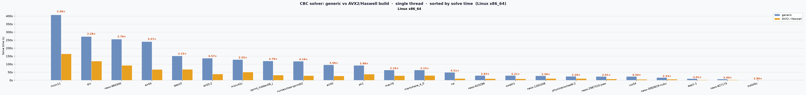

# cbcbox

[](https://pypi.org/project/cbcbox/)
[](https://pypi.org/project/cbcbox/)
[](https://github.com/h-g-s/cbcbox/actions/workflows/wheel.yml)
[](https://pypi.org/project/cbcbox/)
[](https://opensource.org/licenses/EPL-2.0)

**cbcbox** is a high-performance, self-contained Python distribution of the
[CBC](https://github.com/coin-or/Cbc) MILP solver (COIN-OR Branch and Cut),
built from the latest COIN-OR `master` branch.

On x86_64 (Linux, macOS, Windows) the wheel ships both a **[Haswell](https://en.wikipedia.org/wiki/Haswell_(microarchitecture))-optimised** binary
([AVX2](https://en.wikipedia.org/wiki/Advanced_Vector_Extensions)/[FMA](https://en.wikipedia.org/wiki/FMA_instruction_set)) for maximum speed and a **generic** build with
runtime CPU dispatch for compatibility with any x86_64 machine — selected automatically.
All dynamic dependencies ([OpenBLAS](https://github.com/OpenMathLib/OpenBLAS), libgfortran, etc.) are bundled; no system libraries
or separate installation steps are needed.

### Highlights

- **Haswell-optimised & generic builds** — on x86_64 Linux, macOS, and Windows the wheel
  ships two complete solver stacks: a *Haswell* build (OpenBLAS AVX2/FMA kernel) for
  maximum throughput, and a *generic* build (`DYNAMIC_ARCH` runtime dispatch) for
  compatibility with any x86_64 CPU. The best available variant is selected
  automatically at import time (see [Build variants](#build-variants)).

- **Parallel branch-and-cut** — built with `--enable-cbc-parallel`. Use `-threads=N` to
  distribute the search tree across N threads, giving significant speedups on multi-core
  machines for hard MIP instances.

- **AMD fill-reducing ordering** — [SuiteSparse AMD](https://github.com/DrTimothyAldenDavis/SuiteSparse) is compiled in, enabling the
  high-quality `UniversityOfFlorida` Cholesky factorization for Clp's barrier (interior
  point) solver. AMD reordering produces much less fill-in on large sparse problems than
  the built-in native Cholesky, making barrier substantially faster.
  Activate with `-cholesky UniversityOfFlorida -barrier` (see [barrier usage](#barrier-interior-point-solver)).

## Performance (x86\_64)

> *Auto-updated by CI after each successful [workflow run](../../actions/workflows/wheel.yml).
> Single-threaded solve time — lower is better.*

<!-- PERF_SPEEDUP_START -->

The AVX2/Haswell build is **~2.8×** faster than the generic build on average (geometric mean across 30 instances, 3 x86_64 platforms: Darwin x86_64, Linux x86_64, Windows AMD64).

<!-- PERF_SPEEDUP_END -->

<!-- PERF_PLOT_START -->



*Single-threaded solve time across benchmark instances on Linux x86_64, sorted by solve time. Speedup factor shown above each pair. Lower is better.*

See also: [Windows AMD64 + macOS x86_64 summary](https://raw.githubusercontent.com/h-g-s/cbcbox/master/docs/perf_avx2_other.png)

<!-- PERF_PLOT_END -->

## Build variants

On **x86_64 Linux, macOS, and Windows**, the wheel ships three complete sets of binaries:

| Variant | OpenBLAS kernel | Clp SIMD | Flags | Minimum CPU |
|---|---|---|---|---|
| `generic` | `DYNAMIC_ARCH=1` (runtime dispatch, Nehalem–Zen targets) | standard | `-O3` | any x86_64 |
| `avx2` | `DYNAMIC_ARCH=1` + `DYNAMIC_LIST=HASWELL SKYLAKEX` | `-march=haswell -DCOIN_AVX2=4` | `-O3 -march=haswell` | Haswell (2013+) |
| `debug` | same as `avx2` on x86_64, `generic` elsewhere | same as `avx2` on x86_64 | `-O1 -g -fno-omit-frame-pointer` | same as `avx2` |

**Non-x86_64 platforms** (Linux aarch64, macOS arm64) ship `generic` and `debug` only.

At import time `cbcbox` automatically selects `avx2` when available **and** the running CPU supports AVX2; otherwise it falls back to `generic`.

You can override the selection with the `CBCBOX_BUILD` environment variable:

```bash
# Force generic (portable) build
CBCBOX_BUILD=generic cbc mymodel.mps -solve -quit

# Force AVX2-optimised build (raises an error if not available on this platform/CPU)
CBCBOX_BUILD=avx2 cbc mymodel.mps -solve -quit

# Force debug build (full symbols, no optimisation — useful for bug reports and GDB/LLDB)
CBCBOX_BUILD=debug cbc mymodel.mps -solve -quit
```

When `CBCBOX_BUILD` is set, a short summary of the selected build is printed to
stdout on every call — useful for tagging experiment results:

```
[cbcbox] CBCBOX_BUILD=avx2
[cbcbox]   binary  : .../cbcbox/cbc_dist_avx2/bin/cbc
[cbcbox]   lib dir : .../cbcbox/cbc_dist_avx2/lib
[cbcbox]   libs    : libCbc.so.3, libClp.so.3, libopenblas.so.0
```

Set `CBCBOX_VERBOSE=1` to always print this dispatch summary regardless of whether
`CBCBOX_BUILD` is set — useful to confirm which binary is actually being invoked.

## Supported platforms

| Platform | Wheel tag |
|---|---|
| Linux x86\_64 | `manylinux2014_x86_64` |
| Linux aarch64 | `manylinux2014_aarch64` |
| macOS arm64 (Apple Silicon) | `macosx_11_0_arm64` |
| macOS x86\_64 | `macosx_10_9_x86_64` |
| Windows AMD64 | `win_amd64` |

## Installation

```bash
pip install cbcbox
```

## Usage

### Command line

After installation, CBC is available directly as the `cbc` command (pip installs
the entry point into the environment's `bin/` on Linux/macOS or `Scripts/` on Windows,
which is already on PATH):

```bash
cbc mymodel.lp -solve -quit
cbc mymodel.mps.gz -solve -quit
cbc mymodel.mps -seconds 60 -timem elapsed -solve -quit
cbc mymodel.mps -dualp pesteep -solve -quit
```

Alternatively, invoke via the Python module entry point:

```bash
python -m cbcbox mymodel.lp -solve -quit
```

CBC accepts LP, MPS and compressed MPS (`.mps.gz`) files. Pass `-help` for the
full list of options, or `-quit` to exit after solving.

#### Parallel branch-and-cut

This build includes parallel branch-and-cut (`--enable-cbc-parallel`).
Use `-threads=N` to distribute the search tree across N threads:

```bash
cbc mymodel.mps -threads=4 -solve -quit
```

#### Barrier (interior-point) solver

Clp's barrier solver can be faster than simplex for large LP relaxations.
This build includes SuiteSparse AMD, which enables the high-quality
`UniversityOfFlorida` Cholesky factorization — significantly reducing fill-in
compared to the built-in native Cholesky:

```bash
# Solve LP relaxation with barrier + AMD Cholesky, then crossover to simplex basis
cbc mymodel.mps -cholesky UniversityOfFlorida -barrier -solve -quit

# Useful as a root-node strategy inside MIP (let CBC use simplex for B&B):
cbc mymodel.mps -cholesky UniversityOfFlorida -barrier -solve -quit
```

Without AMD, only `-cholesky native` (less efficient) is available.

### Python API

The package exposes helpers to locate the installed files:

```python
import cbcbox
import subprocess

# Path to the cbc binary (cbc.exe on Windows).
cbcbox.cbc_bin_path()
# e.g. '/home/user/.venv/lib/python3.13/site-packages/cbcbox/cbc_dist/bin/cbc'

# Directory containing the shared libraries.
cbcbox.cbc_lib_dir()
# e.g. '.../cbcbox/cbc_dist/lib'

# Directory containing the COIN-OR C/C++ headers.
cbcbox.cbc_include_dir()
# e.g. '.../cbcbox/cbc_dist/include/coin'

# Run CBC programmatically.
result = subprocess.run(
    [cbcbox.cbc_bin_path(), "mymodel.mps", "-solve", "-quit"],
    capture_output=True, text=True,
)
print(result.stdout)
```

## What is built

The build pipeline compiles all components from source inside the CI runner,
in the following order:

| Component | Version / branch | Purpose |
|---|---|---|
| **Cbc** | master | Branch-and-cut MIP solver |
| **Cgl** | master | Cut generation library |
| **Clp** | master | Simplex LP solver (used as the MIP node relaxation) |
| **Osi** | master | Open Solver Interface |
| **CoinUtils** | master | Utility library (shared by all COIN-OR packages) |
| **[AMD](https://github.com/DrTimothyAldenDavis/SuiteSparse)** (SuiteSparse v7.12.2) | v7.12.2 | Sparse matrix fill-reducing ordering |
| **[OpenBLAS](https://github.com/OpenMathLib/OpenBLAS)** | v0.3.31 | Optimised BLAS/LAPACK for LP basis factorisation |

On x86_64 Linux, macOS, and Windows the entire stack is compiled **twice**: once for the
`generic` variant (OpenBLAS `DYNAMIC_ARCH=1` with a broad set of x86_64 targets for
runtime dispatch) and once for the `avx2` variant (OpenBLAS `DYNAMIC_ARCH=1` restricted
to Haswell/Skylake targets via `DYNAMIC_LIST`, COIN-OR compiled with
`-march=haswell -DCOIN_AVX2=4`). Both variants use `NO_CBLAS=1` (COIN-OR only calls
the Fortran BLAS interface). AMD is built only once (it is pure
combinatorial code with no BLAS dependency) and reused by both COIN-OR variants.

The COIN-OR stack (CoinUtils, Osi, Clp, Cgl, Cbc) is always compiled with
`-ffp-contract=off`, which prevents the compiler from fusing separate
multiply/add operations into FMA instructions. FMA computes with extra
intermediate precision, which can introduce tiny (last-bit) numerical
differences that make CBC's branch-and-cut behave inconsistently across
toolchains/architectures; disabling contraction keeps results reproducible.
This flag is not applied to OpenBLAS or AMD, whose own numerics are
unaffected by this concern.

Symmetry detection via Nauty is currently disabled (`--without-nauty`) and
is not part of this build.

All COIN-OR components are built as **shared** (`.so` / `.dylib` / `.dll`)
libraries. The shared libraries are patched with
self-relative RPATHs and bundled inside the wheel, making them directly usable
via `cffi` or `ctypes` without any system installation.

## Wheel contents

The wheel installs under `cbcbox/` inside the site-packages directory.
On x86_64 Linux, macOS, and Windows it contains **two** dist trees; other platforms
contain only `cbc_dist/`:

```
cbc_dist/           ← generic build (all platforms)
cbc_dist_avx2/      ← AVX2-optimised build (x86_64 Linux/macOS/Windows)
├── bin/
│   ├── cbc           # CBC MIP solver binary  (cbc.exe on Windows)
│   └── clp           # Clp LP solver binary   (clp.exe on Windows)
├── lib/
│   ├── libCbc.so / libCbc.dylib / libCbc.dll  # CBC solver
│   ├── libCbcSolver.so ...
│   ├── libClp.so ...                          # Clp LP solver
│   ├── libCgl.so ...                          # Cut generation
│   ├── libOsi.so ...                          # Solver interface
│   ├── libOsiClp.so ...                       # Clp OSI binding
│   ├── libOsiCbc.so ...                       # CBC OSI binding (where available)
│   ├── libCoinUtils.so ...
│   ├── libopenblas.so / .dylib / .dll         # OpenBLAS BLAS/LAPACK
│   ├── pkgconfig/                             # .pc files for all libraries
│   └── <bundled runtime shared libs>          # Platform-specific — see below
└── include/
    ├── coin/      # COIN-OR headers (CoinUtils, Osi, Clp, Cgl, Cbc)
    └── *.h        # SuiteSparse / AMD headers
```

### Bundled dynamic libraries

Because OpenBLAS links to the Fortran runtime, the following shared libraries are bundled inside the wheel
and their paths are rewritten so no system installation is required.

#### Linux (`lib/` directory, RPATH set to `$ORIGIN`)

| Library | Description |
|---|---|
| `libopenblas.so.0` | OpenBLAS BLAS/LAPACK |
| `libgfortran.so.5` | GNU Fortran runtime |
| `libquadmath.so.0` | Quad-precision math (dependency of libgfortran) |

#### macOS (`lib/` directory, install names rewritten to `@rpath/`)

| Library | Description |
|---|---|
| `libopenblas.dylib` | OpenBLAS BLAS/LAPACK |
| `libgfortran.5.dylib` | GNU Fortran runtime |
| `libgcc_s.1.1.dylib` | GCC runtime |
| `libquadmath.0.dylib` | Quad-precision math |

#### Windows (`bin/` directory, DLLs placed next to the executable)

| Library | Description |
|---|---|
| `libopenblas.dll` | OpenBLAS BLAS/LAPACK |
| `libgfortran-5.dll` | GNU Fortran runtime |
| `libgcc_s_seh-1.dll` | GCC SEH runtime |
| `libquadmath-0.dll` | Quad-precision math |
| `libstdc++-6.dll` | C++ standard library (MinGW64) |
| `libwinpthread-1.dll` | POSIX thread emulation |

## CI / build pipeline

Wheels are built and tested automatically via GitHub Actions using
[cibuildwheel](https://cibuildwheel.pypa.io).  The workflow
(`.github/workflows/wheel.yml`) runs independent compile jobs in parallel,
then packages each platform:

| Compile jobs | Runner | Produces |
|---|---|---|
| `compile-linux-x64-generic` + `compile-linux-x64-avx2` | `ubuntu-latest` | `manylinux2014_x86_64` wheel |
| `compile-linux-arm64-generic` | `ubuntu-24.04-arm` | `manylinux2014_aarch64` wheel |
| `compile-macos-arm64-generic` | `macos-15` | `macosx_11_0_arm64` wheel |
| `compile-macos-intel-generic` + `compile-macos-intel-avx2` | `macos-15-intel` | `macosx_10_9_x86_64` wheel |
| `compile-windows-generic` + `compile-windows-avx2` | `windows-latest` | `win_amd64` wheel |

Each platform's compile jobs run in parallel. Once all compile jobs for a
platform finish, the corresponding `package-*` job assembles the wheel via
cibuildwheel and runs the test suite against the installed wheel.

A final `combine_reports` job collects per-platform performance results and
commits the updated `README.md` to the repository.

### Integration tests

The test suite (`pytest`) solves 24 MIP instances and checks the optimal
objective values, in both single-threaded and parallel (3-thread) modes.
On x86_64 Linux, macOS, and Windows **each test is run twice** — once against
the `generic` binary and once against the `avx2` binary — and a side-by-side
performance comparison is recorded:

| Instance | Expected optimal | Time limit |
|---|---|---|
| `pp08a` | 7 350 | 2000 s |
| `sprint_hidden06_j` | 130 | 2000 s |
| `air03` | 340 160 | 2000 s |
| `air04` | 56 137 | 2000 s |
| `air05` | 26 374 | 2000 s |
| `nw04` | 16 862 | 2000 s |
| `mzzv11` | −21 718 | 2000 s |
| `trd445c` | −153 419.078836 | 2000 s |
| `nursesched-sprint02` | 58 | 2000 s |
| `stein45` | 30 | 2000 s |
| `neos-810286` | 2 877 | 2000 s |
| `neos-1281048` | 601 | 2000 s |
| `j3050_8` | 1 | 2000 s |
| `qiu` | −132.873136947 | 2000 s |
| `gesa2-o` | 25 779 856.3717 | 2000 s |
| `pk1` | 11 | 2000 s |
| `mas76` | 40 005.054142 | 2000 s |
| `app1-1` | −3 | 2000 s |
| `eil33-2` | 934.007916 | 2000 s |
| `fiber` | 405 935.18 | 2000 s |
| `neos-2987310-joes` | −607 702 988.291 | 2000 s |
| `neos-827175` | 112.00152 | 2000 s |
| `neos-3083819-nubu` | 6307996 | 2000 s |
| `markshare_4_0` | 1 | 2000 s |

Time limits are generous to avoid false failures on slow CI runners.

## Performance results

> *Auto-updated by CI after each successful
> [workflow run](../../actions/workflows/wheel.yml).*

<!-- PERF_RESULTS_START -->

## Summary

Geometric mean solve time (seconds) across all test instances.

### 1 thread

| Platform | generic (s) | avx2 (s) | avx2 speedup |
|---|---|---|---|
| Darwin x86_64 | 73.44 | 23.70 | 3.10× |
| Darwin arm64 | 56.35 | — | — |
| Linux x86_64 | 41.15 | 14.04 | 2.93× |
| Windows AMD64 | 46.58 | 18.72 | 2.49× |

### 3 threads

| Platform | generic (s) | avx2 (s) | avx2 speedup |
|---|---|---|---|
| Darwin x86_64 | 49.69 | 14.83 | 3.35× |
| Darwin arm64 | 35.90 | — | — |
| Linux x86_64 | 26.29 | 8.29 | 3.17× |
| Windows AMD64 | 30.71 | 11.15 | 2.75× |

## Per-instance results

### `pp08a`

| Platform | Build | 1 thread (s) | 3 threads (s) | parallel speedup |
|---|---|---|---|---|
| Darwin x86_64 | avx2 | 31.18 | 10.02 | 3.11× |
| Darwin x86_64 | generic | 93.98 | 60.41 | 1.56× |
| Darwin arm64 | generic | 60.31 | 16.61 | 3.63× |
| Linux x86_64 | avx2 | 16.99 | 4.97 | 3.42× |
| Linux x86_64 | generic | 48.06 | 40.90 | 1.18× |
| Windows AMD64 | avx2 | 22.31 | 6.92 | 3.22× |
| Windows AMD64 | generic | 44.61 | 35.83 | 1.25× |

### `sprint_hidden06_j`

| Platform | Build | 1 thread (s) | 3 threads (s) | parallel speedup |
|---|---|---|---|---|
| Darwin x86_64 | avx2 | 56.60 | 58.30 | 0.97× |
| Darwin x86_64 | generic | 191.11 | 156.08 | 1.22× |
| Darwin arm64 | generic | 147.07 | 141.44 | 1.04× |
| Linux x86_64 | avx2 | 31.66 | 31.63 | 1.00× |
| Linux x86_64 | generic | 120.11 | 120.76 | 0.99× |
| Windows AMD64 | avx2 | 47.64 | 46.89 | 1.02× |
| Windows AMD64 | generic | 154.90 | 106.19 | 1.46× |

### `air03`

| Platform | Build | 1 thread (s) | 3 threads (s) | parallel speedup |
|---|---|---|---|---|
| Darwin x86_64 | avx2 | 9.03 | 9.99 | 0.90× |
| Darwin x86_64 | generic | 63.25 | 60.43 | 1.05× |
| Darwin arm64 | generic | 41.94 | 43.27 | 0.97× |
| Linux x86_64 | avx2 | 8.06 | 8.37 | 0.96× |
| Linux x86_64 | generic | 34.12 | 34.62 | 0.99× |
| Windows AMD64 | avx2 | 7.59 | 7.74 | 0.98× |
| Windows AMD64 | generic | 52.29 | 52.69 | 0.99× |

### `air04`

| Platform | Build | 1 thread (s) | 3 threads (s) | parallel speedup |
|---|---|---|---|---|
| Darwin x86_64 | avx2 | 59.48 | 41.36 | 1.44× |
| Darwin x86_64 | generic | 298.01 | 171.60 | 1.74× |
| Darwin arm64 | generic | 221.41 | 131.93 | 1.68× |
| Linux x86_64 | avx2 | 67.38 | 28.41 | 2.37× |
| Linux x86_64 | generic | 240.74 | 112.95 | 2.13× |
| Windows AMD64 | avx2 | 85.81 | 34.77 | 2.47× |
| Windows AMD64 | generic | 327.67 | 151.08 | 2.17× |

### `air05`

| Platform | Build | 1 thread (s) | 3 threads (s) | parallel speedup |
|---|---|---|---|---|
| Darwin x86_64 | avx2 | 31.44 | 40.73 | 0.77× |
| Darwin x86_64 | generic | 127.60 | 92.15 | 1.38× |
| Darwin arm64 | generic | 101.67 | 74.69 | 1.36× |
| Linux x86_64 | avx2 | 26.90 | 23.00 | 1.17× |
| Linux x86_64 | generic | 95.79 | 77.35 | 1.24× |
| Windows AMD64 | avx2 | 32.80 | 26.85 | 1.22× |
| Windows AMD64 | generic | 128.71 | 102.97 | 1.25× |

### `nw04`

| Platform | Build | 1 thread (s) | 3 threads (s) | parallel speedup |
|---|---|---|---|---|
| Darwin x86_64 | avx2 | 5.10 | 28.57 | 0.18× |
| Darwin x86_64 | generic | 27.91 | 152.13 | 0.18× |
| Darwin arm64 | generic | 21.87 | 114.93 | 0.19× |
| Linux x86_64 | avx2 | 5.20 | 18.88 | 0.28× |
| Linux x86_64 | generic | 23.43 | 81.63 | 0.29× |
| Windows AMD64 | avx2 | 5.18 | 19.58 | 0.26× |
| Windows AMD64 | generic | 29.46 | 103.86 | 0.28× |

### `mzzv11`

| Platform | Build | 1 thread (s) | 3 threads (s) | parallel speedup |
|---|---|---|---|---|
| Darwin x86_64 | avx2 | 142.80 | 261.02 | 0.55× |
| Darwin x86_64 | generic | 343.96 | 633.57 | 0.54× |
| Darwin arm64 | generic | 311.29 | 518.56 | 0.60× |
| Linux x86_64 | avx2 | 164.26 | 70.94 | 2.32× |
| Linux x86_64 | generic | 407.36 | 167.69 | 2.43× |
| Windows AMD64 | avx2 | 185.50 | 100.16 | 1.85× |
| Windows AMD64 | generic | 261.50 | 280.17 | 0.93× |

### `trd445c`

| Platform | Build | 1 thread (s) | 3 threads (s) | parallel speedup |
|---|---|---|---|---|
| Darwin x86_64 | avx2 | 0.83 | 0.81 | 1.03× |
| Darwin x86_64 | generic | 1.47 | 1.87 | 0.79× |
| Darwin arm64 | generic | 1.13 | 1.37 | 0.83× |
| Linux x86_64 | avx2 | 0.48 | 0.47 | 1.02× |
| Linux x86_64 | generic | 1.34 | 1.24 | 1.09× |
| Windows AMD64 | avx2 | 0.66 | 0.62 | 1.06× |
| Windows AMD64 | generic | 1.46 | 1.39 | 1.05× |

### `nursesched-sprint02`

| Platform | Build | 1 thread (s) | 3 threads (s) | parallel speedup |
|---|---|---|---|---|
| Darwin x86_64 | avx2 | 59.35 | 52.37 | 1.13× |
| Darwin x86_64 | generic | 147.17 | 150.40 | 0.98× |
| Darwin arm64 | generic | 154.65 | 126.60 | 1.22× |
| Linux x86_64 | avx2 | 28.39 | 20.86 | 1.36× |
| Linux x86_64 | generic | 118.19 | 83.25 | 1.42× |
| Windows AMD64 | avx2 | 43.28 | 31.24 | 1.39× |
| Windows AMD64 | generic | 105.69 | 86.82 | 1.22× |

### `stein45`

| Platform | Build | 1 thread (s) | 3 threads (s) | parallel speedup |
|---|---|---|---|---|
| Darwin x86_64 | avx2 | 11.63 | 62.69 | 0.19× |
| Darwin x86_64 | generic | 28.30 | 238.21 | 0.12× |
| Darwin arm64 | generic | 24.58 | 141.01 | 0.17× |
| Linux x86_64 | avx2 | 7.26 | 39.36 | 0.18× |
| Linux x86_64 | generic | 18.89 | 122.85 | 0.15× |
| Windows AMD64 | avx2 | 9.26 | 39.11 | 0.24× |
| Windows AMD64 | generic | 23.52 | 99.91 | 0.24× |

### `neos-810286`

| Platform | Build | 1 thread (s) | 3 threads (s) | parallel speedup |
|---|---|---|---|---|
| Darwin x86_64 | avx2 | 17.50 | 13.89 | 1.26× |
| Darwin x86_64 | generic | 45.24 | 45.94 | 0.98× |
| Darwin arm64 | generic | 44.63 | 41.51 | 1.08× |
| Linux x86_64 | avx2 | 10.04 | 10.98 | 0.91× |
| Linux x86_64 | generic | 29.40 | 24.68 | 1.19× |
| Windows AMD64 | avx2 | 13.82 | 11.82 | 1.17× |
| Windows AMD64 | generic | 34.67 | 29.95 | 1.16× |

### `neos-1281048`

| Platform | Build | 1 thread (s) | 3 threads (s) | parallel speedup |
|---|---|---|---|---|
| Darwin x86_64 | avx2 | 11.82 | 19.60 | 0.60× |
| Darwin x86_64 | generic | 26.80 | 70.47 | 0.38× |
| Darwin arm64 | generic | 27.17 | 53.91 | 0.50× |
| Linux x86_64 | avx2 | 10.85 | 7.74 | 1.40× |
| Linux x86_64 | generic | 27.84 | 23.69 | 1.18× |
| Windows AMD64 | avx2 | 14.41 | 11.01 | 1.31× |
| Windows AMD64 | generic | 14.82 | 23.52 | 0.63× |

### `j3050_8`

| Platform | Build | 1 thread (s) | 3 threads (s) | parallel speedup |
|---|---|---|---|---|
| Darwin x86_64 | avx2 | 3.67 | 4.83 | 0.76× |
| Darwin x86_64 | generic | 7.46 | 15.76 | 0.47× |
| Darwin arm64 | generic | 7.01 | 10.55 | 0.67× |
| Linux x86_64 | avx2 | 1.45 | 2.91 | 0.50× |
| Linux x86_64 | generic | 4.32 | 10.19 | 0.42× |
| Windows AMD64 | avx2 | 1.98 | 4.24 | 0.47× |
| Windows AMD64 | generic | 4.82 | 10.13 | 0.48× |

### `qiu`

| Platform | Build | 1 thread (s) | 3 threads (s) | parallel speedup |
|---|---|---|---|---|
| Darwin x86_64 | avx2 | 204.43 | 39.46 | 5.18× |
| Darwin x86_64 | generic | 496.11 | 112.25 | 4.42× |
| Darwin arm64 | generic | 468.27 | 97.53 | 4.80× |
| Linux x86_64 | avx2 | 119.48 | 23.38 | 5.11× |
| Linux x86_64 | generic | 272.35 | 55.77 | 4.88× |
| Windows AMD64 | avx2 | 162.98 | 31.96 | 5.10× |
| Windows AMD64 | generic | 325.47 | 74.11 | 4.39× |

### `gesa2-o`

| Platform | Build | 1 thread (s) | 3 threads (s) | parallel speedup |
|---|---|---|---|---|
| Darwin x86_64 | avx2 | 18.15 | 4.08 | 4.45× |
| Darwin x86_64 | generic | 47.96 | 14.74 | 3.25× |
| Darwin arm64 | generic | 42.52 | 8.54 | 4.98× |
| Linux x86_64 | avx2 | 12.31 | 3.62 | 3.40× |
| Linux x86_64 | generic | 31.81 | 10.32 | 3.08× |
| Windows AMD64 | avx2 | 18.19 | 4.88 | 3.73× |
| Windows AMD64 | generic | 31.16 | 11.83 | 2.64× |

### `pk1`

| Platform | Build | 1 thread (s) | 3 threads (s) | parallel speedup |
|---|---|---|---|---|
| Darwin x86_64 | avx2 | 61.33 | 2.81 | 21.81× |
| Darwin x86_64 | generic | 166.63 | 8.75 | 19.03× |
| Darwin arm64 | generic | 121.27 | 4.73 | 25.65× |
| Linux x86_64 | avx2 | 37.52 | 1.69 | 22.19× |
| Linux x86_64 | generic | 92.88 | 4.33 | 21.43× |
| Windows AMD64 | avx2 | 46.89 | 2.31 | 20.31× |
| Windows AMD64 | generic | 122.56 | 5.75 | 21.31× |

### `mas76`

| Platform | Build | 1 thread (s) | 3 threads (s) | parallel speedup |
|---|---|---|---|---|
| Darwin x86_64 | avx2 | 41.01 | 2.63 | 15.60× |
| Darwin x86_64 | generic | 107.06 | 7.53 | 14.22× |
| Darwin arm64 | generic | 75.25 | 4.34 | 17.33× |
| Linux x86_64 | avx2 | 28.36 | 0.98 | 29.05× |
| Linux x86_64 | generic | 63.64 | 3.49 | 18.25× |
| Windows AMD64 | avx2 | 28.84 | 1.25 | 23.06× |
| Windows AMD64 | generic | 70.26 | 3.23 | 21.74× |

### `app1-1`

| Platform | Build | 1 thread (s) | 3 threads (s) | parallel speedup |
|---|---|---|---|---|
| Darwin x86_64 | avx2 | 6.11 | 5.23 | 1.17× |
| Darwin x86_64 | generic | 21.59 | 19.09 | 1.13× |
| Darwin arm64 | generic | 13.98 | 15.34 | 0.91× |
| Linux x86_64 | avx2 | 3.13 | 3.27 | 0.96× |
| Linux x86_64 | generic | 9.44 | 9.31 | 1.01× |
| Windows AMD64 | avx2 | 4.67 | 4.36 | 1.07× |
| Windows AMD64 | generic | 13.07 | 13.16 | 0.99× |

### `eil33-2`

| Platform | Build | 1 thread (s) | 3 threads (s) | parallel speedup |
|---|---|---|---|---|
| Darwin x86_64 | avx2 | 49.57 | 44.64 | 1.11× |
| Darwin x86_64 | generic | 189.61 | 166.97 | 1.14× |
| Darwin arm64 | generic | 157.81 | 149.50 | 1.06× |
| Linux x86_64 | avx2 | 38.57 | 41.16 | 0.94× |
| Linux x86_64 | generic | 137.54 | 150.49 | 0.91× |
| Windows AMD64 | avx2 | 52.62 | 57.96 | 0.91× |
| Windows AMD64 | generic | 166.18 | 171.51 | 0.97× |

### `fiber`

| Platform | Build | 1 thread (s) | 3 threads (s) | parallel speedup |
|---|---|---|---|---|
| Darwin x86_64 | avx2 | 3.06 | 2.94 | 1.04× |
| Darwin x86_64 | generic | 8.25 | 6.71 | 1.23× |
| Darwin arm64 | generic | 5.93 | 4.90 | 1.21× |
| Linux x86_64 | avx2 | 0.85 | 1.06 | 0.80× |
| Linux x86_64 | generic | 2.93 | 3.98 | 0.74× |
| Windows AMD64 | avx2 | 1.24 | 1.59 | 0.78× |
| Windows AMD64 | generic | 4.02 | 4.14 | 0.97× |

### `neos-2987310-joes`

| Platform | Build | 1 thread (s) | 3 threads (s) | parallel speedup |
|---|---|---|---|---|
| Darwin x86_64 | avx2 | 18.17 | 11.26 | 1.61× |
| Darwin x86_64 | generic | 57.89 | 30.49 | 1.90× |
| Darwin arm64 | generic | 30.08 | 21.52 | 1.40× |
| Linux x86_64 | avx2 | 8.11 | 5.97 | 1.36× |
| Linux x86_64 | generic | 23.61 | 15.93 | 1.48× |
| Windows AMD64 | avx2 | 12.94 | 9.47 | 1.37× |
| Windows AMD64 | generic | 28.80 | 22.11 | 1.30× |

### `neos-3083819-nubu`

| Platform | Build | 1 thread (s) | 3 threads (s) | parallel speedup |
|---|---|---|---|---|
| Darwin x86_64 | avx2 | 11.25 | 13.61 | 0.83× |
| Darwin x86_64 | generic | 31.56 | 37.91 | 0.83× |
| Darwin arm64 | generic | 24.79 | 29.92 | 0.83× |
| Linux x86_64 | avx2 | 6.44 | 5.78 | 1.11× |
| Linux x86_64 | generic | 16.28 | 14.29 | 1.14× |
| Windows AMD64 | avx2 | 9.56 | 8.67 | 1.10× |
| Windows AMD64 | generic | 19.65 | 14.84 | 1.32× |

### `markshare_4_0`

| Platform | Build | 1 thread (s) | 3 threads (s) | parallel speedup |
|---|---|---|---|---|
| Darwin x86_64 | avx2 | 52.88 | 2.11 | 25.06× |
| Darwin x86_64 | generic | 118.30 | 4.40 | 26.88× |
| Darwin arm64 | generic | 60.48 | 3.15 | 19.18× |
| Linux x86_64 | avx2 | 29.52 | 0.88 | 33.44× |
| Linux x86_64 | generic | 63.57 | 2.73 | 23.32× |
| Windows AMD64 | avx2 | 27.93 | 1.03 | 27.15× |
| Windows AMD64 | generic | 69.08 | 2.38 | 29.08× |

### `irp`

| Platform | Build | 1 thread (s) | 3 threads (s) | parallel speedup |
|---|---|---|---|---|
| Darwin x86_64 | avx2 | 25.14 | 8.01 | 3.14× |
| Darwin x86_64 | generic | 137.64 | 50.23 | 2.74× |
| Darwin arm64 | generic | 111.35 | 37.67 | 2.96× |
| Linux x86_64 | avx2 | 10.93 | 4.50 | 2.43× |
| Linux x86_64 | generic | 49.29 | 17.88 | 2.76× |
| Windows AMD64 | avx2 | 14.68 | 5.22 | 2.81× |
| Windows AMD64 | generic | 61.03 | 27.07 | 2.25× |

### `qap10`

| Platform | Build | 1 thread (s) | 3 threads (s) | parallel speedup |
|---|---|---|---|---|
| Darwin x86_64 | avx2 | 83.30 | 39.48 | 2.11× |
| Darwin x86_64 | generic | 206.23 | 111.12 | 1.86× |
| Darwin arm64 | generic | 162.30 | 101.84 | 1.59× |
| Linux x86_64 | avx2 | 68.26 | 25.28 | 2.70× |
| Linux x86_64 | generic | 152.06 | 55.43 | 2.74× |
| Windows AMD64 | avx2 | 95.23 | 35.18 | 2.71× |
| Windows AMD64 | generic | 203.17 | 75.54 | 2.69× |

### `swath1`

| Platform | Build | 1 thread (s) | 3 threads (s) | parallel speedup |
|---|---|---|---|---|
| Darwin x86_64 | avx2 | 18.65 | 34.96 | 0.53× |
| Darwin x86_64 | generic | 63.56 | 123.24 | 0.52× |
| Darwin arm64 | generic | 44.60 | 92.38 | 0.48× |
| Linux x86_64 | avx2 | 9.07 | 19.21 | 0.47× |
| Linux x86_64 | generic | 29.10 | 65.79 | 0.44× |
| Windows AMD64 | avx2 | 12.60 | 28.26 | 0.45× |
| Windows AMD64 | generic | 36.88 | 70.28 | 0.52× |

### `physiciansched6-2`

| Platform | Build | 1 thread (s) | 3 threads (s) | parallel speedup |
|---|---|---|---|---|
| Darwin x86_64 | avx2 | 11.72 | 9.11 | 1.29× |
| Darwin x86_64 | generic | 89.16 | 83.22 | 1.07× |
| Darwin arm64 | generic | 50.94 | 51.46 | 0.99× |
| Linux x86_64 | avx2 | 10.83 | 8.71 | 1.24× |
| Linux x86_64 | generic | 23.83 | 19.97 | 1.19× |
| Windows AMD64 | avx2 | 16.80 | 14.16 | 1.19× |
| Windows AMD64 | generic | 55.49 | 54.34 | 1.02× |

### `mzzv42z`

| Platform | Build | 1 thread (s) | 3 threads (s) | parallel speedup |
|---|---|---|---|---|
| Darwin x86_64 | avx2 | 106.84 | 102.93 | 1.04× |
| Darwin x86_64 | generic | 281.97 | 270.38 | 1.04× |
| Darwin arm64 | generic | 180.37 | 234.72 | 0.77× |
| Linux x86_64 | avx2 | 50.41 | 43.33 | 1.16× |
| Linux x86_64 | generic | 128.69 | 116.05 | 1.11× |
| Windows AMD64 | avx2 | 75.93 | 70.36 | 1.08× |
| Windows AMD64 | generic | 153.45 | 140.39 | 1.09× |

### `neos-860300`

| Platform | Build | 1 thread (s) | 3 threads (s) | parallel speedup |
|---|---|---|---|---|
| Darwin x86_64 | avx2 | 171.46 | 48.83 | 3.51× |
| Darwin x86_64 | generic | 400.84 | 114.43 | 3.50× |
| Darwin arm64 | generic | 361.29 | 104.28 | 3.46× |
| Linux x86_64 | avx2 | 92.56 | 28.09 | 3.30× |
| Linux x86_64 | generic | 255.90 | 96.50 | 2.65× |
| Windows AMD64 | avx2 | 151.50 | 49.41 | 3.07× |
| Windows AMD64 | generic | 96.41 | 57.94 | 1.66× |

### `neos-827175`

| Platform | Build | 1 thread (s) | 3 threads (s) | parallel speedup |
|---|---|---|---|---|
| Darwin x86_64 | avx2 | — | 3.99 | — |
| Darwin x86_64 | generic | — | 12.39 | — |
| Darwin arm64 | generic | — | 7.54 | — |
| Linux x86_64 | avx2 | 2.99 | 2.29 | 1.31× |
| Linux x86_64 | generic | 7.17 | 5.78 | 1.24× |
| Windows AMD64 | avx2 | 4.56 | 3.48 | 1.31× |
| Windows AMD64 | generic | 9.44 | 7.01 | 1.35× |


<!-- PERF_RESULTS_END -->

## NAQ — Never Asked Questions

### Why not benchmark on the full [MIPLIB 2017](https://miplib.zib.de/) library?

Several practical constraints shape the benchmark set:

1. **CI time limits.**  GitHub Actions enforces a 6-hour wall-clock limit per
   job.  The full MIPLIB 2017 collection contains ~240 instances, many of
   which take hours even on fast hardware.  Including all of them would make
   every CI run time out before producing any useful measurements.

2. **Comparing apples to apples requires instances solved to optimality.**  If
   some instances are only solved within a time limit (i.e., a gap > 0 %), a
   meaningful performance comparison must account for both solve time *and*
   solution quality simultaneously.  This greatly complicates analysis and
   makes plots harder to interpret.  Restricting to instances that CBC reliably
   solves to proven optimality keeps the comparison clean: a single elapsed-time
   number per instance is all that is needed.

3. **The instance set is intentionally biased toward set packing / covering /
   partitioning structure.**  Most instances in the benchmark (`pp08a`,
   `sprint_hidden06_j`, `nw04`, `mzzv11`, `nursesched-sprint02`, `air0x`,
   `trd445c`) contain large blocks of set packing, covering, or partitioning
   constraints.  This structure arises naturally in applications such as crew
   scheduling, nurse scheduling, vehicle routing, and cutting stock —
   exactly the domain where [column generation](https://en.wikipedia.org/wiki/Column_generation)
   is most valuable.  Since the benchmark focuses on this problem class rather
   than providing a general-purpose solver survey, it is a specially interesting use case.

## Local debug builds

The released wheels include an optimised build and a **debug build** (see
[Build variants](#build-variants)).  For most debugging needs, `CBCBOX_BUILD=debug`
is all you need.  If you want to rebuild with a sanitizer or need exact parity
with the CI container, use the scripts in `scripts/`.

| Script | Platform | Environment | Output directory |
|---|---|---|---|
| `scripts/build_debug.sh` | Linux, macOS | native (host compiler) | `cbc_dist_debug_avx2/` (x86_64) or `cbc_dist_debug/` (ARM64) |
| `scripts/build_debug_manylinux.sh` | Linux | Docker — manylinux_2_28 container (exact CI parity) | same as above |
| `scripts/build_debug_windows.ps1` | Windows | MSYS2 / MinGW64 | `cbc_dist_debug_avx2\` |

### Quick start

**Linux / macOS (native build):**

```bash
# x86_64 → debug + AVX2 → cbc_dist_debug_avx2/bin/cbc
# ARM64  → debug only  → cbc_dist_debug/bin/cbc
./scripts/build_debug.sh

# With AddressSanitizer (Linux/macOS only):
./scripts/build_debug.sh --asan

# With ThreadSanitizer:
./scripts/build_debug.sh --tsan

# Force a clean rebuild from scratch (required when switching sanitizers):
./scripts/build_debug.sh --asan --clean
```

**Linux (manylinux_2_28 container — matches CI exactly):**

```bash
# Requires Docker; the script prints install instructions if it is missing.
./scripts/build_debug_manylinux.sh
./scripts/build_debug_manylinux.sh --asan
./scripts/build_debug_manylinux.sh --tsan
```

**Windows (PowerShell):**

```powershell
# Requires MSYS2 at C:\msys64.  Note: sanitizers are not supported on Windows/MinGW.
.\scripts\build_debug_windows.ps1
.\scripts\build_debug_windows.ps1 -Clean   # force full rebuild
```

### Debugging

```bash
# GDB (Linux):
gdb cbc_dist_debug_avx2/bin/cbc
(gdb) run mymodel.mps -solve -quit

# LLDB (macOS):
lldb cbc_dist_debug/bin/cbc
(lldb) run mymodel.mps -solve -quit
```

### Sanitizer tips

> **Note:** The debug build shipped in the wheel does **not** include a sanitizer.
> Use the local build scripts above (`--asan` / `--tsan`) on your development
> machine to enable sanitizer instrumentation.

| Sanitizer | Flag | What it catches | Runtime env var |
|---|---|---|---|
| AddressSanitizer | `--asan` | heap/stack buffer overflows, use-after-free, memory leaks | `ASAN_OPTIONS=detect_leaks=0` to suppress system-lib false positives |
| ThreadSanitizer  | `--tsan` | data races between threads | `TSAN_OPTIONS=halt_on_error=0` to log races without aborting |

ASan and TSan are mutually exclusive.  Neither is available on Windows/MinGW.
Always pass `--clean` when switching from one sanitizer to another to avoid
linking mismatched object files.

OpenBLAS is always built **without** sanitizer flags to avoid false positives
from hand-optimised BLAS assembly; only the COIN-OR stack is instrumented.

## License

CBC and all COIN-OR components are distributed under the
[Eclipse Public License 2.0](https://opensource.org/licenses/EPL-2.0).
OpenBLAS is distributed under the BSD 3-Clause licence.
SuiteSparse AMD is distributed under the BSD 3-Clause licence.
